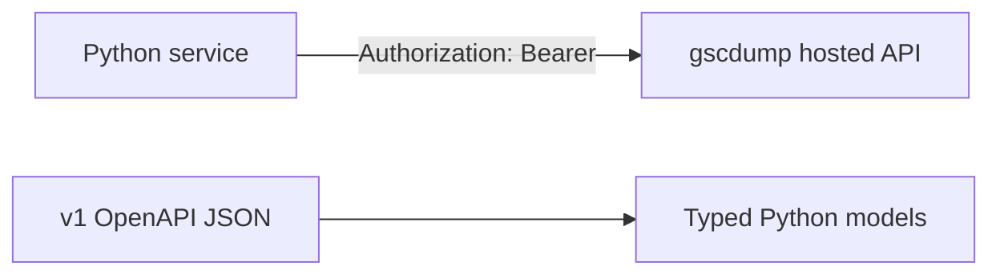

# Call the hosted API from Python

Query hosted analytics from a Python service with `httpx` and a server-held Bearer API key. Generate typed models or a client from the v1 OpenAPI documents.



## Before you start

Complete [Hosted first result](/gscdump-sdk/guides/start/hosted-first-result) to create a user API key and copy your Site ID (`s_...`). Install `httpx` in your Python environment (`pip install httpx` or `uv add httpx`). Set `GSCDUMP_API_KEY` and `GSCDUMP_SITE_ID` in the server environment.

Hosted v1 requires `Authorization: Bearer <GSCDUMP_API_KEY>`. Do not send `X-API-Key` on v1 endpoints.

## Query rows and Reports with httpx

Use one shared `httpx.Client` for requests to `https://gscdump.com`. Both `POST /api/analytics/v1/sites/{siteId}/rows` and `POST /api/analytics/v1/sites/{siteId}/reports` are idempotent queries, so bounded retries are safe when an error envelope reports `retryable: true`.

```python
from __future__ import annotations

import email.utils
import os
import time
from typing import Any

import httpx

BASE_URL = "https://gscdump.com"
EXPECTED_API_VERSION = "1.0"
MAX_ATTEMPTS = 3


class GscdumpApiError(RuntimeError):
    def __init__(
        self,
        *,
        status_code: int,
        code: str,
        message: str,
        request_id: str | None,
        retryable: bool,
        details: dict[str, Any],
    ) -> None:
        super().__init__(f"{code} (status={status_code}, request_id={request_id}): {message}")
        self.status_code = status_code
        self.code = code
        self.request_id = request_id
        self.retryable = retryable
        self.details = details


def parse_retry_after(header_value: str | None) -> float | None:
    if not header_value:
        return None
    try:
        return max(0.0, float(header_value))
    except ValueError:
        pass
    try:
        target = email.utils.parsedate_to_datetime(header_value)
    except (TypeError, ValueError):
        return None
    return max(0.0, target.timestamp() - time.time())


def post_idempotent(
    client: httpx.Client,
    path: str,
    payload: dict[str, Any],
) -> dict[str, Any]:
    for attempt in range(1, MAX_ATTEMPTS + 1):
        response = client.post(path, json=payload)
        api_version = response.headers.get("GSCdump-API-Version")
        if api_version and api_version != EXPECTED_API_VERSION:
            raise RuntimeError(f"Unexpected GSCdump-API-Version: {api_version}")

        if response.is_success:
            return response.json()

        try:
            body = response.json() if response.content else {}
        except ValueError:
            body = {}

        err = body.get("error") if isinstance(body, dict) else None
        if not isinstance(err, dict):
            if response.status_code in (429, 503) and attempt < MAX_ATTEMPTS:
                retry_after = parse_retry_after(response.headers.get("Retry-After"))
                backoff = min(2.0, 0.25 * (2 ** (attempt - 1)))
                time.sleep(max(backoff, retry_after or 0.0))
                continue
            response.raise_for_status()

        api_error = GscdumpApiError(
            status_code=response.status_code,
            code=str(err.get("code", "unknown_error")),
            message=str(err.get("message", "Request failed")),
            request_id=err.get("requestId") or response.headers.get("x-request-id"),
            retryable=bool(err.get("retryable", False)),
            details=err.get("details") if isinstance(err.get("details"), dict) else {},
        )

        if api_error.retryable and attempt < MAX_ATTEMPTS:
            retry_after = parse_retry_after(response.headers.get("Retry-After"))
            backoff = min(2.0, 0.25 * (2 ** (attempt - 1)))
            time.sleep(max(backoff, retry_after or 0.0))
            continue

        raise api_error

    raise RuntimeError("Retry budget exhausted")


api_key = os.environ["GSCDUMP_API_KEY"]
site_id = os.environ["GSCDUMP_SITE_ID"]

with httpx.Client(
    base_url=BASE_URL,
    headers={
        "Authorization": f"Bearer {api_key}",
        "Accept": "application/json",
    },
    timeout=30.0,
) as client:
    rows_response = post_idempotent(
        client,
        f"/api/analytics/v1/sites/{site_id}/rows",
        {
            "dimensions": ["query"],
            "metrics": ["clicks", "impressions"],
            "searchType": "web",
            "rowLimit": 100,
        },
    )
    print(rows_response["data"]["rows"], rows_response["meta"]["requestId"])

    report_response = post_idempotent(
        client,
        f"/api/analytics/v1/sites/{site_id}/reports",
        {
            "state": {
                "dimensions": ["query"],
                "searchType": "web",
            },
        },
    )
    report = report_response["data"]
    print(report["totals"], report["meta"]["syncStatus"], report["meta"]["newestDateSynced"])
```

Every successful v1 response returns `{ "data": ..., "meta": ... }` and sends `GSCdump-API-Version: 1.0`, `x-request-id`, `Cache-Control: private, no-store`, and `Vary: Authorization`. List Reports reject the `date` dimension. When you need daily series, call `POST /api/analytics/v1/sites/{siteId}/reports/detail`.

## Handle errors and rate limits

Every v1 failure returns `{ "error": { "code", "message", "requestId", "retryable", "details" } }`. Branch on `error.code` and `error.retryable`, and log `error.requestId` without logging `Authorization`.

| Status | Meaning | Action |
| --- | --- | --- |
| `429 rate_limited` | Rate limit reached for this credential and operation | Wait for `Retry-After` before retrying |
| `503` with `retryable: true` | Limiter or upstream temporarily unavailable (`Retry-After: 5` on limiter fail-closed) | Wait for `Retry-After` and retry idempotent operations |
| `401` or `403` | Invalid key, missing scope, or unauthorized Site | Fix credentials or Site access; do not retry |
| `409 invalid_request` | Domain refusal, such as `record_not_ready` or `range_not_synced` in `error.details.reason` | Inspect `error.details`; an immediate retry returns the same refusal |

Only retry operations whose OpenAPI `x-gscdump-semantics.retry` value is `"idempotent"`. Do not automatically retry mutations marked `retry: "never"`. See [Errors and retry](/gscdump-sdk/guides/operate/errors-and-retry) and the [hosted HTTP reference](/gscdump-sdk/api/hosted-http#idempotency-and-retries) for the exact mutation list.

## Generate typed Python models or a client

The hosted API publishes OpenAPI 3.1 documents for each HTTP surface:

- Analytics surface: `https://gscdump.com/openapi/analytics.v1.json`
- Partner surface: `https://gscdump.com/openapi/partner.v1.json`
- Realtime HTTP surface: `https://gscdump.com/openapi/realtime.v1.json`

Generate Pydantic v2 models with `datamodel-code-generator`:

```bash
pip install "datamodel-code-generator[http]" pydantic
datamodel-codegen \
  --url https://gscdump.com/openapi/analytics.v1.json \
  --input-file-type openapi \
  --output-model-type pydantic_v2.BaseModel \
  --output gscdump_analytics_models.py
```

Or generate a full `httpx`-based Python client with `openapi-python-client`:

```bash
pip install openapi-python-client
openapi-python-client generate \
  --url https://gscdump.com/openapi/partner.v1.json \
  --output-path ./gscdump_partner_client
```

For offline builds or version-pinned specs, export the same OpenAPI documents locally from `@gscdump/contracts/v1`:

```ts
import { writeFile } from 'node:fs/promises'
import { createGscdumpV1Documents } from '@gscdump/contracts/v1'

const documents = createGscdumpV1Documents()
await writeFile('openapi.analytics.v1.json', JSON.stringify(documents['openapi.analytics.v1.json'], null, 2))
await writeFile('openapi.partner.v1.json', JSON.stringify(documents['openapi.partner.v1.json'], null, 2))
```

Then pass `--input openapi.analytics.v1.json` to `datamodel-codegen` or `--path openapi.partner.v1.json` to `openapi-python-client generate`. Configure generated response models to ignore unknown keys so additive v1 fields stay compatible.

## Check the result

Run your script with valid `GSCDUMP_API_KEY` and `GSCDUMP_SITE_ID` values. Confirm the rows response prints `data.rows` and `meta.requestId`, and the Report response prints `data.totals` and `data.meta.syncStatus`. Test an invalid key to verify your error handler logs `code` and `requestId` without printing the API key. Continue with [Hosted analytics](/gscdump-sdk/guides/read-data/hosted-analytics) for Report semantics.
