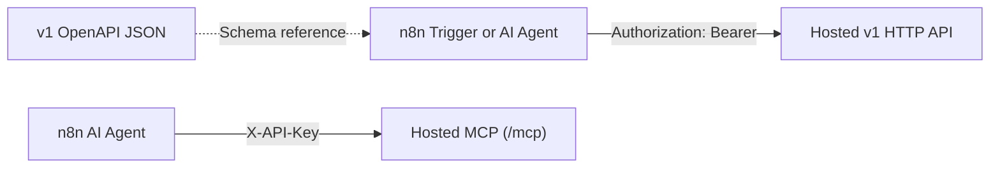

# Connect n8n workflows and AI agents

Read hosted Search Console data in n8n using built-in HTTP and MCP nodes. Use the HTTP Request node for scheduled automations, or attach an HTTP Request Tool or MCP Client Tool to an n8n AI Agent.



## Before you start

Complete [Hosted first result](/gscdump-sdk/guides/start/hosted-first-result) to create a user API key and copy your Site ID (`s_...`).

Hosted v1 HTTP endpoints and hosted MCP use different authentication headers:

| Surface | URL prefix | Header in n8n |
| --- | --- | --- |
| Hosted v1 HTTP API | `https://gscdump.com/api/analytics/v1/...`, `https://gscdump.com/api/partner/v1/...` | `Authorization: Bearer <GSCDUMP_API_KEY>` via **Bearer Auth** |
| Hosted MCP server | `https://gscdump.com/mcp` | `X-API-Key: <GSCDUMP_API_KEY>` via **Header Auth** (or OAuth 2.0) |

Do not send `X-API-Key` to hosted v1 HTTP endpoints.

## Query rows or Fleet totals from an HTTP Request node

Use the **HTTP Request** node for scheduled workflows, such as a weekly Slack digest or a database sync.

1. Add an **HTTP Request** node after a **Schedule Trigger** node.
2. Set **Method** to `POST`.
3. Set **URL** to `https://gscdump.com/api/analytics/v1/sites/YOUR_SITE_ID/rows`, replacing `YOUR_SITE_ID` with your `s_...` Site ID.
4. Set **Authentication** to **Generic Credential Type**, then select **Bearer Auth**.
5. Create a new credential named `gscdump Hosted v1`, paste your user API key into **Bearer Token**, and save it.
6. Enable **Send Body**, set **Body Content Type** to **JSON**, and choose **Specify Body: Using JSON**.
7. Paste this request body:

```json
{
  "dimensions": ["query"],
  "metrics": ["clicks", "impressions", "ctr", "position"],
  "searchType": "web",
  "orderBy": {
    "column": "clicks",
    "dir": "desc"
  },
  "rowLimit": 25
}
```

Run the node. A successful call returns `{ "data": { "rows": [...] }, "meta": { "requestId": "..." } }`.

Connect a **Split Out** node on `data.rows` to pass each query row to Slack, Notion, or Sheets.

To check click changes across every connected Site in one call, send a `POST` request to `https://gscdump.com/api/analytics/v1/fleet/summary`:

```json
{
  "period": "last-7d",
  "comparison": "prev-period",
  "searchType": "web",
  "sortBy": "clicksDelta",
  "sortDir": "asc"
}
```

Read `{{ $json.data.sites }}` for per-Site deltas. Read `{{ $json.data.deduplicatedTotals }}` for Fleet totals.

## Connect an n8n AI Agent

Choose the tool node that fits how much freedom the agent should have.

### Narrow scope: HTTP Request Tool

Use **HTTP Request Tool** when the agent should call one fixed endpoint.

1. Attach an **HTTP Request Tool** node to the **AI Agent** node's **Tool** port.
2. Select your `gscdump Hosted v1` Bearer Auth credential.
3. Set the endpoint URL and JSON payload template.
4. Name the fields the model may fill, such as `rowLimit` or `searchType`, in the tool description.

### Full toolset: MCP Client Tool

Use **MCP Client Tool** when the agent should choose from all Search Console tools.

1. Attach an **MCP Client Tool** node to the **AI Agent** node.
2. Set the server URL to `https://gscdump.com/mcp`.
3. Choose **Header Auth** with header name `X-API-Key` and your user API key as the value.

See the [MCP setup guide](/mcp) for the full tool list.

## Check schemas with OpenAPI

The hosted API publishes OpenAPI 3.1 JSON documents for each HTTP surface:

- Analytics surface: `https://gscdump.com/openapi/analytics.v1.json`
- Partner surface: `https://gscdump.com/openapi/partner.v1.json`
- Realtime HTTP surface: `https://gscdump.com/openapi/realtime.v1.json`

Check these documents for valid enum values, required fields, and response keys when building n8n payloads or Code nodes.

## Configure retries and handle errors

Every v1 failure returns `{ "error": { "code", "message", "requestId", "retryable", "details" } }`.

- **Retries:** Turn on **Retry On Fail** in node **Settings** only for idempotent reads (`rows`, `reports`, `fleet/summary`, and `GET` calls). Set **Wait Between Tries** to at least `2000` ms and cap **Max Tries** at `3`.
- **Non-idempotent mutations:** Leave retries off on mutations marked `retry: "never"`. See the [hosted HTTP reference](/gscdump-sdk/api/hosted-http#idempotency-and-retries) for that list.
- **`401` or `403`:** Confirm you selected **Bearer Auth** on v1 URLs and that the key holds the required scope.
- **`409 invalid_request`:** Read `error.details.reason`, such as `record_not_ready` or `range_not_synced`. Retrying immediately returns the same refusal.
- **Error logs:** Log `error.code` and `error.requestId` in your n8n error workflow. Never log the `Authorization` header.

## Check the result

1. Run **Test step** on your HTTP Request node with a valid Site ID.
2. Confirm the output includes `data.rows` (or `data.sites` for Fleet summary) and `meta.requestId`.
3. To verify `GSCdump-API-Version: 1.0`, temporarily enable **Options → Response → Include Response Headers and Status** (turn it back off so `data.rows` stays at the top level).
4. Test once with an invalid API key to confirm your error workflow catches `401` cleanly.

Continue with [Hosted analytics](/gscdump-sdk/guides/read-data/hosted-analytics) for Report filters and comparison windows.
