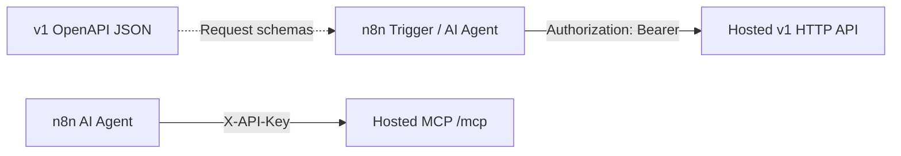

# Connect n8n workflows and AI agents

Read hosted Search Console data in n8n with zero custom code. Use the HTTP Request node for scheduled automations, or wire an HTTP Request Tool or MCP Client Tool into an n8n AI Agent.



## Before you start

Complete [Hosted first result](/gscdump-sdk/guides/start/hosted-first-result) to create a user API key and copy your Site ID (`s_...`).

Keep the two authentication headers separate:

| Surface | URL prefix | Header in n8n |
| --- | --- | --- |
| Hosted v1 HTTP API | `https://gscdump.com/api/analytics/v1/...`, `https://gscdump.com/api/partner/v1/...` | `Authorization: Bearer <GSCDUMP_API_KEY>` via **Bearer Auth** |
| Hosted MCP server | `https://gscdump.com/mcp` | `X-API-Key: <GSCDUMP_API_KEY>` via **Header Auth** (or OAuth 2.0) |

Do not send `X-API-Key` to hosted v1 HTTP endpoints.

## Create one Bearer Auth credential in n8n

Create a reusable credential before configuring workflow nodes so your API key never sits in plain JSON expressions.

1. In n8n, open **Credentials** and select **Add Credential**.
2. Search for **Bearer Auth** and select it.
3. Paste your `gscdump` user API key into **Token** and name the credential `gscdump Hosted v1`.
4. Save the credential.

## Query rows or Fleet totals from an HTTP Request node

Use the **HTTP Request** node for deterministic scheduled workflows, such as a weekly Slack digest or a database sync.

1. Add an **HTTP Request** node after a **Schedule Trigger** node.
2. Set **Method** to `POST`.
3. Set **URL** to `https://gscdump.com/api/analytics/v1/sites/YOUR_SITE_ID/rows` (replace `YOUR_SITE_ID` with your `s_...` Site ID).
4. Set **Authentication** to **Generic Credential Type**, then select **Bearer Auth** and pick `gscdump Hosted v1`.
5. Enable **Send Body**, set **Body Content Type** to **JSON**, and choose **Specify Body: Using JSON**.
6. Paste this request body:

```json
{
  "dimensions": ["query"],
  "metrics": ["clicks", "impressions", "ctr", "position"],
  "searchType": "web",
  "orderBy": {
    "column": "clicks",
    "dir": "desc"
  },
  "rowLimit": 25
}
```

Execute the node. A successful call returns `{ "data": { "rows": [...] }, "meta": { "requestId": "..." } }`. Connect a **Split Out** node on `data.rows` to iterate over each query row in downstream Slack, Notion, or Sheets nodes.

To monitor click changes across every connected Site in one call, send a `POST` request to `https://gscdump.com/api/analytics/v1/fleet/summary`:

```json
{
  "period": "last-7d",
  "comparison": "prev-period",
  "searchType": "web",
  "sortBy": "clicksDelta",
  "sortDir": "asc"
}
```

Read `{{ $json.data.sites }}` for per-Site deltas and `{{ $json.data.deduplicatedTotals }}` for Fleet totals.

## Connect an n8n AI Agent

Pick the tool type that matches how tightly you want to constrain the agent:

- **Use `HTTP Request Tool` when you want one narrow, predictable endpoint.** Attach an **HTTP Request Tool** node to your **AI Agent** node's **Tool** port, select the same `gscdump Hosted v1` Bearer Auth credential, and paste the endpoint URL and JSON template. Describe the exact fields the model may fill, such as `rowLimit` or `searchType`, in the tool description.
- **Use `MCP Client Tool` when the agent should pick across all Search Console tools.** Attach an **MCP Client Tool** node to the **AI Agent** node, point it at `https://gscdump.com/mcp`, and configure **Header Auth** with header name `X-API-Key` and your user API key as the value. See the [MCP setup guide](/mcp) for available tools.

## Inspect schemas with OpenAPI

The hosted API publishes OpenAPI 3.1 JSON documents for every HTTP surface:

- Analytics surface: `https://gscdump.com/openapi/analytics.v1.json`
- Partner surface: `https://gscdump.com/openapi/partner.v1.json`
- Realtime HTTP surface: `https://gscdump.com/openapi/realtime.v1.json`

Use these documents to verify valid enum values, required fields, and response keys when configuring n8n **HTTP Request** payloads or custom Code nodes.

## Configure retries and handle errors

Every v1 failure returns `{ "error": { "code", "message", "requestId", "retryable", "details" } }`.

- Open the HTTP Request node's **Settings** tab and turn on **Retry On Fail** only for idempotent read endpoints (`rows`, `reports`, `fleet/summary`, and `GET` reads). Set **Wait Between Tries** to at least `2000` ms and cap **Max Tries** at `3`.
- Do not enable automatic retries on mutations marked `retry: "never"` in the OpenAPI schema. See the [hosted HTTP reference](/gscdump-sdk/api/hosted-http#idempotency-and-retries) for the exact list.
- If a node receives `401` or `403`, verify you selected **Bearer Auth** (not `X-API-Key`) on v1 URLs and that the key holds the required scope.
- If a node receives `409 invalid_request`, inspect `error.details.reason` (for example `record_not_ready` or `range_not_synced`). Repeating the same request immediately returns the same refusal.
- Log `error.code` and `error.requestId` in your n8n error workflow. Never log the `Authorization` header.

## Check the result

Run **Test step** on your HTTP Request node with a valid Site ID. Confirm the output panel contains `data.rows` (or `data.sites` for Fleet summary) and `meta.requestId`, and verify the `GSCdump-API-Version: 1.0` response header when **Include Response Headers and Status** is enabled. Test once with a bogus token to confirm your error branch catches `401` cleanly. Continue with [Hosted analytics](/gscdump-sdk/guides/read-data/hosted-analytics) for Report filters and comparison windows.
