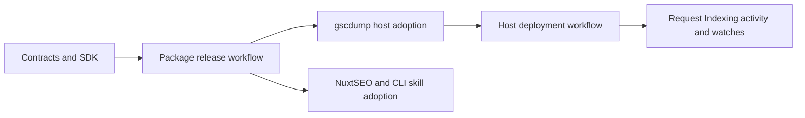

# AI surface parity

This brief covers the package work requested after the 10 November parity sweep.
The hosted engine and consumers remain separate repositories.

## Package scope

- Run deterministic Hosted reports through a canonical operation and SDK method.
- Bind feedback to safe request, workflow, product, surface, and skill context.
- Redact credentials and private content before transmission and storage.
- Measure skill freshness by complete artifact content, including references.
- Expose credential-bound integration activity to partner consumers.
- Carry safe attribution headers through SDK and CLI calls.
- Preserve unavailable, partial, and truncated evidence in every output.

## Consumer sequence

Package release requires the reviewed change on main and the release workflow.
Consumers adopt published pins. Local tarballs support verification before release.
Feedback closure requires a verified fix reference and regression evidence.
Historical smoke reports do not represent customer defects.

## Done means

- Package checks cover Hosted reports without a Store or Google calls.
- Invalid correlation fields fail before a network request.
- Unknown activity counts remain null.
- Feedback sanitization runs at both client and host boundaries.
- A same-version reference change makes the installed skill stale.
- Host uses the package contracts without duplicating the data plane.
- Request Indexing reads partner activity from credential-bound engine observations.
- Published artifacts and deployed consumer workflows pass their release checks.

## Related source

- `packages/contracts/src/agent-feedback.ts`
- `packages/contracts/src/v1/agent-usage.ts`
- `packages/contracts/src/v1/report.ts`
- `packages/sdk/src/v1/http.ts`
- `packages/cli/src/hosted-report.ts`
- `packages/cli/src/skill.ts`
